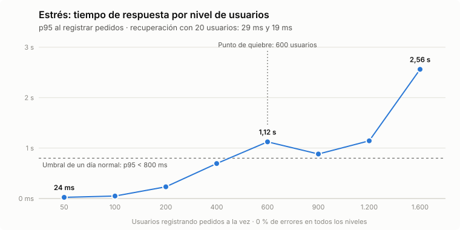
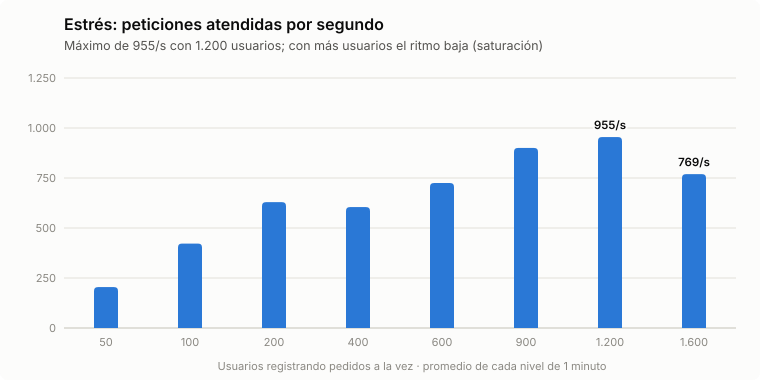
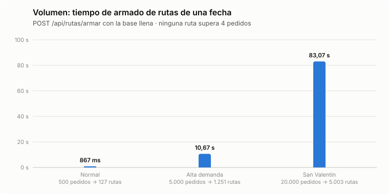
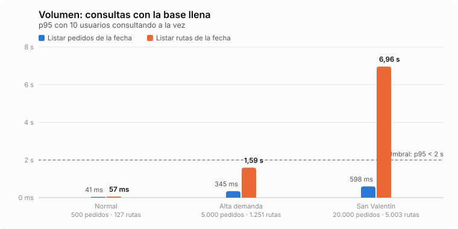

# Informe de pruebas de volumen, carga y estrés

Sistema de Gestión de Entregas y Rutas (Logística de Última Milla). GPIS, Sexto A, Grupo D.
Responsable: Robert Paredes. Ejecución: 19 de noviembre de 2026.

Scripts y cómo repetir cada prueba: [`tests/performance/README.md`](../../../tests/performance/README.md).
Resúmenes de k6 de cada ejecución (`--summary-export`): [`tests/performance/reports/`](../../../tests/performance/reports/).
Las gráficas se generan desde esos resúmenes con `node tests/performance/graficas.js` (carpeta [`graficas/`](graficas/)).

## 1. Resumen

| Prueba | Resultado | Lo más importante |
|---|---|---|
| Carga (día normal, 20 usuarios) | Cumple | 0 % de errores; p95 de 29 ms al registrar pedidos y de 13 a 15 ms al consultar |
| Estrés (hasta 1 600 usuarios) | Punto de quiebre en **600 usuarios** | El p95 pasa de 800 ms con 600 usuarios a la vez. Ningún error hasta 1 600 usuarios. Se recupera por completo al bajar la carga |
| Volumen (500, 5 000 y 20 000 pedidos) | Cumple salvo listar rutas en San Valentín | Listar rutas tarda 6,96 s (p95) con 5 003 rutas en una fecha. Armar las rutas de San Valentín tarda 83 s |
| Concurrencia (último momento) | Cumple | En 3 rondas, hasta 1 006 pedidos con 150 usuarios a la vez: ninguna ruta con más de 4 pedidos, ningún pedido en dos rutas |

## 2. Entorno

Todo corre en el mismo portátil, por lo que los resultados son un **límite inferior**: en el nivel más alto, k6 compite por
la CPU con el backend y la base de datos.

| Elemento | Detalle |
|---|---|
| Equipo | Intel Core i7-13700H (20 hilos), 16 GB de RAM, Windows 11 (de 1 a 2 GB de RAM libres durante las pruebas) |
| Backend | Spring Boot 4.1.2 en Java 21, perfil `dev`, con `SEGURIDAD_HABILITADA=true` (login con JWT) |
| Base de datos | PostgreSQL 16.4 + PostGIS en Docker Desktop (contenedor `logistica-postgis`) |
| Herramienta | k6 v2.3.0. Cada usuario virtual inicia sesión como `staff` y manda su token en cada petición |
| Regla de negocio | Máximo 4 pedidos por ruta (`logistica.rutas.max-pedidos`) |

## 3. Cómo se pobló el sistema

El enunciado pide probar con una base realista, no vacía. Se usaron dos herramientas de `tests/data/`:

1. **Volumen histórico, directo en la base** (`tests/data/volumen.sql`): **100 000 pedidos entregados** en fechas del
   último año, dentro de las zonas activas, agrupados en rutas finalizadas de hasta 4 pedidos y con su historial completo
   de estados (400 000 filas). Simula un año de operación. Carga en unos 10 segundos.
2. **Tres escenarios de demanda, por la API** (`tests/data/generar-pedidos.js`), así cada pedido pasa por las mismas
   validaciones que en el uso real (zona del punto, fecha y hora de entrega). Simula un día pico: horas concentradas entre
   las 10:00 y las 19:00, más pedidos en el centro, 10 % urgentes y 20 % de prioridad alta.

| Escenario | Pedidos | Fecha | Repartidores disponibles | Tiempo de carga | Pedidos/s |
|---|---|---|---|---|---|
| Normal | 500 | 2028-02-12 | 40 | 0,7 s | 714 |
| Alta demanda | 5 000 | 2028-02-13 | 40 | 5,1 s | 980 |
| San Valentín extremo | 20 000 | 2028-02-14 | 80 (40 creados por el generador) | 20,6 s | 971 |

Estado de la base después de todas las pruebas: **859 761 pedidos** (100 000 históricos y 354 176 creados por la prueba de
estrés), 38 810 rutas, 452 392 cambios de estado en el historial, 761 755 clientes, 80 repartidores y 6 zonas activas.
Tamaño de la base: 454 MB.

## 4. Carga: un día normal

20 personas del negocio trabajando a la vez durante 1 min 45 s (30 s de subida, 1 min estable, 15 s de bajada). Cada
acción: 60 % registra un pedido, 25 % consulta la primera página de los pedidos del día, 15 % consulta las rutas del día.
Entre acciones, 1 segundo de pausa. Reporte: `reports/carga.json`.

| Operación | Promedio | p95 | Máximo | Umbral (p95) |
|---|---|---|---|---|
| Registrar pedido | 19,6 ms | 29,1 ms | 273 ms | < 800 ms ✅ |
| Consultar pedidos del día | 10,1 ms | 15,5 ms | 57 ms | < 800 ms ✅ |
| Consultar rutas del día | 7,8 ms | 13,1 ms | 63 ms | < 1,5 s ✅ |

1 660 peticiones (15,6 por segundo), **0 % de errores** y el 100 % de los checks correctos. El sistema atiende un día normal
con mucho margen.

## 5. Estrés: punto de quiebre y recuperación

Los usuarios suben por niveles; cada nivel dura 1 minuto (15 s de subida y 45 s estable) y todos registran pedidos sin
parar (0,2 s de pausa). Cada petición se etiqueta con su nivel y se compara con los umbrales de un día normal (p95 < 800 ms
y errores < 1 %). Al final se vuelve a 20 usuarios para ver si el sistema se recupera. Reportes: `reports/estres.json`
(hasta 600) y `reports/estres-alto.json` (900 a 1 600).

| Usuarios a la vez | Peticiones | Peticiones/s | Promedio | p95 | Máximo | Errores |
|---|---|---|---|---|---|---|
| 50 | 12 271 | ~205 | 13 ms | 24 ms | 72 ms | 0 % |
| 100 | 25 328 | ~422 | 21 ms | 49 ms | 435 ms | 0 % |
| 200 | 37 756 | ~629 | 96 ms | 233 ms | 634 ms | 0 % |
| 400 | 36 275 | ~605 | 416 ms | 694 ms | 1,79 s | 0 % |
| **600** | 43 493 | ~725 | 589 ms | **1,12 s** ❌ | 2,40 s | 0 % |
| 900 | 54 015 | ~900 | 671 ms | 883 ms ❌ | 1,38 s | 0 % |
| 1 200 | 57 284 | ~955 | 1,01 s | 1,14 s ❌ | 1,41 s | 0 % |
| 1 600 | 46 159 | ~769 | 1,81 s | 2,56 s ❌ | 3,75 s | 0 % |
| Recuperación (20), primera ronda | 6 005 | — | 16 ms | 29 ms | 82 ms | 0 % |
| Recuperación (20), segunda ronda | 6 114 | — | 13 ms | 19 ms | 54 ms | 0 % |

**Punto de quiebre:**

- **Por tiempo de respuesta, en 600 usuarios a la vez:** es el primer nivel cuyo p95 supera los 800 ms de un día normal.
- **El ritmo deja de crecer desde 200 usuarios** (unas 600 a 700 peticiones por segundo), con un máximo de unas
  **955 peticiones por segundo** con 1 200 usuarios. Con 1 600 usuarios **baja** a unas 770 por segundo, mientras el p95
  sube a 2,56 s: es la saturación.
- **No hubo errores en ningún nivel** (349 593 peticiones en las dos rondas). El sistema no se cae: pone las peticiones en
  cola y responde más lento.
- **Se recupera por completo:** al volver a 20 usuarios el p95 baja a 19–29 ms, igual que antes del estrés.

No se subió de 1 600 usuarios porque a partir de ahí el propio k6 compite por la CPU con el backend en el mismo equipo, y
la medición dejaría de ser confiable.

## 6. Volumen: consultas y armado con la base llena

Con la base de la sección 3, se midieron durante 1 minuto las consultas de pedidos y rutas de cada fecha (10 usuarios a
la vez) y el armado de rutas de toda la fecha. Reportes: `reports/volumen-*.json`.

### Armado de rutas

| Escenario | Pedidos | Rutas armadas | Mínimo posible (pedidos ÷ 4) | Máximo por ruta | Tiempo |
|---|---|---|---|---|---|
| Normal | 500 | 127 | 125 | 4 | 0,87 s |
| Alta demanda | 5 000 | 1 251 | 1 250 | 4 | 10,7 s |
| San Valentín | 20 000 | 5 003 | 5 000 | 4 | **83,1 s** |

El algoritmo deja casi la cantidad mínima de rutas: sobra como mucho una ruta incompleta por zona. Ninguna ruta pasa de
4 pedidos. El armado de San Valentín tarda 1 min 23 s; corre a las 18:00 del día anterior (armado programado), así que no
afecta a los usuarios, pero si se dispara a mano desde la web el usuario espera ese tiempo.

### Consultas (con las rutas ya armadas)

| Escenario | Listar pedidos de la fecha (p95) | Listar rutas de la fecha (p95) | Umbral rutas |
|---|---|---|---|
| Normal (127 rutas) | 41 ms | 57 ms | < 2 s ✅ |
| Alta demanda (1 251 rutas) | 345 ms | 1,59 s | < 2 s ✅ |
| San Valentín (5 003 rutas) | 598 ms | **6,96 s** | < 2 s ❌ |

Listar pedidos escala bien porque está paginado. **Listar rutas crece en proporción a la cantidad de rutas**, porque cada
respuesta trae todas las rutas de la fecha con todos sus pedidos completos. Reportado a backend en
[#31](https://github.com/Mauri10G/Logistica_Ultima_Milla/issues/31).

**Después de la corrección de Joseph** (#36: el listado se arma en una sola consulta y las respuestas van comprimidas),
medido el mismo día con la misma base (reportes `volumen-*-consultas-despues.json`):

| Escenario | Listar rutas p95, antes | Listar rutas p95, después | Listar pedidos p95, después |
|---|---|---|---|
| Alta demanda (1 251 rutas) | 1,59 s | **0,70 s** ✅ | 230 ms |
| San Valentín (5 003 rutas) | 6,96 s | **2,80 s** ❌ | 278 ms |

La consulta es 2,5 veces más rápida y alta demanda ya cumple el umbral. San Valentín sigue por encima de 2 s porque la
respuesta todavía trae las 5 003 rutas con sus 20 000 pedidos: para bajar de ahí hace falta paginar el listado o devolver
un resumen por ruta.

## 7. Concurrencia: pedidos de último momento a la vez

Requisito crítico del enunciado: con muchas solicitudes simultáneas, una ruta nunca supera el máximo y un pedido nunca
queda en dos rutas. `tests/performance/concurrencia.js` registra 6 pedidos en una fecha, arma sus rutas (4 + 2, una con
espacio) y lanza una ráfaga de pedidos **en la misma zona y fecha**, donde chocan. Como la fecha ya tiene rutas, el
backend inserta cada pedido como último momento. Al mismo tiempo 5 usuarios vuelven a armar la misma fecha. Al final se
verifica por la API y por SQL (`verificar-concurrencia.sql`).

| Ronda | Pedidos | Usuarios a la vez | Rutas | Máximo por ruta | Pedidos en dos rutas | Posiciones repetidas | Rechazos | p95 |
|---|---|---|---|---|---|---|---|---|
| 1 | 206 | 50 | 52 | 4 | 0 | 0 | 0 | 1,39 s |
| 2 | 1 006 | 150 | 252 | 4 | 0 | 0 | 0 | 23,3 s |
| 3 | 1 006 | 150 | 252 | 4 | 0 | 0 | 0 | 8,7 s |

- **La regla se cumple en todas las rondas.** Las rutas quedan con el mínimo posible (pedidos ÷ 4) y la verificación en
  SQL devuelve 0 filas en sus tres comprobaciones.
- **Con 150 usuarios a la vez sube el tiempo de respuesta**, porque las inserciones de una misma zona y fecha esperan su
  turno en el bloqueo (`pg_advisory_xact_lock` + `PESSIMISTIC_WRITE`): se atienden en fila, unas 7 por segundo. Es el
  precio de la garantía de concurrencia, y solo pasa si todos los pedidos van a la misma zona y fecha a la vez.
- **Hallazgo intermitente:** una ronda previa a las tres de la tabla, también con 1 000 pedidos y 150 usuarios, tuvo 229
  rechazos (23 %), sin rastro en el log del backend. Aun así, ningún pedido quedó duplicado ni ninguna ruta se pasó del
  máximo. No se repitió en las tres rondas siguientes, que ya registraban el código HTTP de cada rechazo. El patrón
  (tiempo mínimo de 0 s y nada en el log) apunta a un corte de conexión en el propio equipo, pero no está confirmado.

## 8. Conclusiones y mejoras propuestas

1. **El sistema atiende con holgura un día normal** (p95 < 30 ms con 20 usuarios) y sigue respondiendo sin errores con 1 600
   usuarios registrando pedidos sin pausa, aunque más lento. El punto de quiebre por tiempo de respuesta está en unos 600
   usuarios a la vez y la capacidad máxima medida es de unas 955 peticiones por segundo, en un portátil.
2. **La garantía de concurrencia funciona:** en ninguna prueba hubo rutas con más de 4 pedidos ni pedidos en dos rutas.
3. **Mejora prioritaria: listar rutas.** Con la corrección del #36 bajó de 6,96 s a 2,80 s con 5 003 rutas, pero sigue sobre
   el umbral: falta paginar `GET /api/rutas` o devolver un resumen sin los pedidos completos.
4. **El armado de San Valentín tarda 83 s.** Está bien como proceso programado, pero si se dispara a mano conviene
   ejecutarlo en segundo plano y avisar por WebSocket (`/topic/rutas`) cuando termine, en lugar de esperar la respuesta HTTP.
5. **Inserciones de último momento en una misma zona y fecha:** se atienden una a la vez (unas 7 por segundo). Si en una
   fecha pico llegan cientos a la vez a una sola zona, el usuario espera varios segundos. Una mejora posible es encolarlas
   y responder de inmediato con el pedido `PENDIENTE`, asignándolo cuando le toque.
6. **Repetir las pruebas en un servidor separado** del cliente de carga, para medir la capacidad real sin que k6 compita
   por la CPU.
